# Eddilicious Foods

Online shop, catering booking and admin panel for Eddilicious Foods, a Nigerian food business in Swansea that cooks soups, stews, rice dishes and party platters to order and delivers across the UK.

I built this end to end for the owner: storefront, checkout, accounts, owner notifications, a mobile-first admin and first-party analytics. It runs on ordinary shared PHP hosting, which shaped most of the technical decisions below.

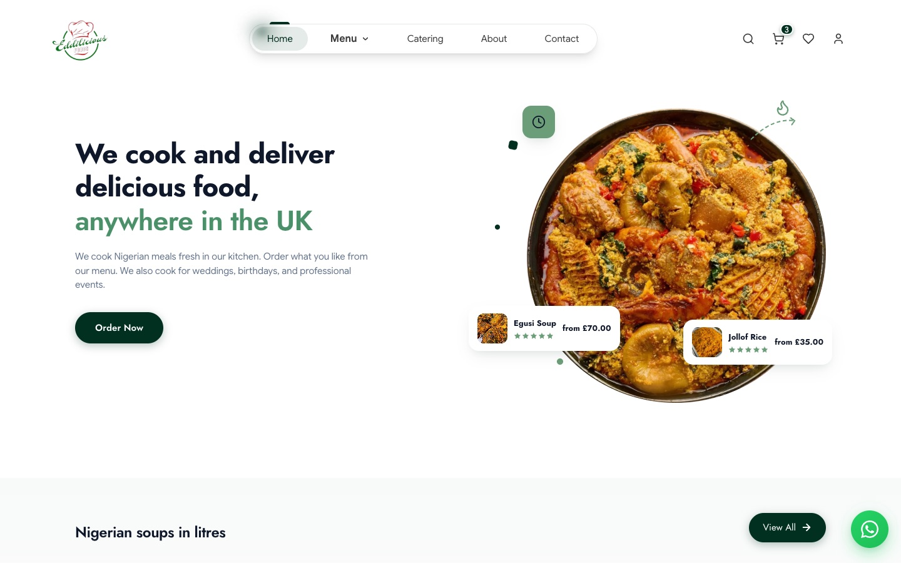

## Contents

- [What it does](#what-it-does)
- [Screenshots](#screenshots)
- [Stack](#stack)
- [How it is put together](#how-it-is-put-together)
- [Checkout and payments](#checkout-and-payments)
- [Accounts and admin access](#accounts-and-admin-access)
- [Menu data: code plus database overrides](#menu-data-code-plus-database-overrides)
- [Analytics and consent](#analytics-and-consent)
- [Front end](#front-end)
- [Running it locally](#running-it-locally)
- [Configuration](#configuration)
- [Trade-offs and what I would do next](#trade-offs-and-what-i-would-do-next)

## What it does

**For customers**

- Browse the menu by category. Litre-based dishes come in 2 or 4 litres, platters are sold by the tray.
- Product pages with a gallery (photos or short looping videos), size picker, quantity, and reviews.
- Basket and wishlist that live in the browser, so nobody has to sign in to start shopping.
- Checkout in three steps: details, delivery or collection, then pay with Stripe Checkout.
- A required allergy policy acknowledgement before payment. This was a legal must-have for the owner.
- Coupon codes, including one-per-customer codes checked against past orders.
- Passwordless sign-in by email code, or Google.
- Verified-purchase reviews: you can only review a meal you have actually paid for.
- Catering request form for weddings, birthdays and work events, with date validation and a drinks selector.
- Contact form, newsletter sign-up, WhatsApp chat button, cookie consent banner and a one-per-visit terms notice.
- Every order needs at least 24 hours' notice, because ingredients are bought fresh per order. The copy for this lives in one file.

**For the owner**

- Sales overview with revenue and order counts for today, 7 days, 30 days, all time or a custom range.
- Order list filtered by status (paid, pending, failed, cancelled) with customer contact details.
- Meal manager: edit the built-in menu or add new dishes, upload up to five photos or videos per meal, write descriptions in a small rich text editor, hide or delete items in bulk.
- Coupon manager. One coupon is live at a time and it drives the homepage promo banner automatically.
- Website analytics: page views, sessions, visitors, bounce rate, traffic sources, devices, cities, top pages. Optional Google Analytics demographics.
- A WhatsApp message to the owner's phone the moment an order is paid.
- A searchable user manual inside the admin, written for a non-technical owner.
- The whole admin works on a phone. Tables turn into cards under 1024px, because the owner runs the business from her phone.

## Screenshots

### Storefront

| Menu | Product |
| --- | --- |
| 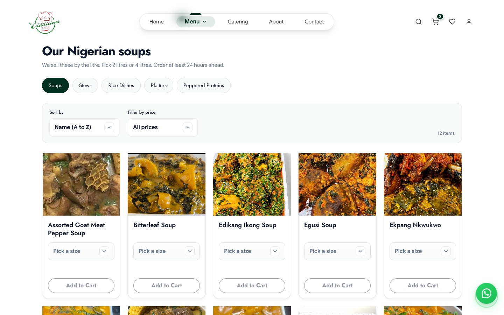 | 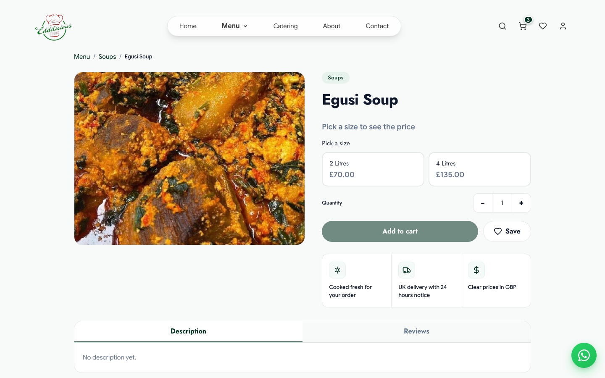 |

| Basket | Catering |
| --- | --- |
| 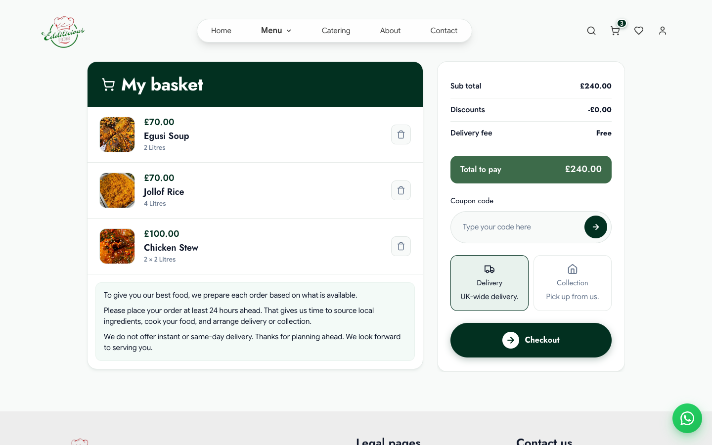 | 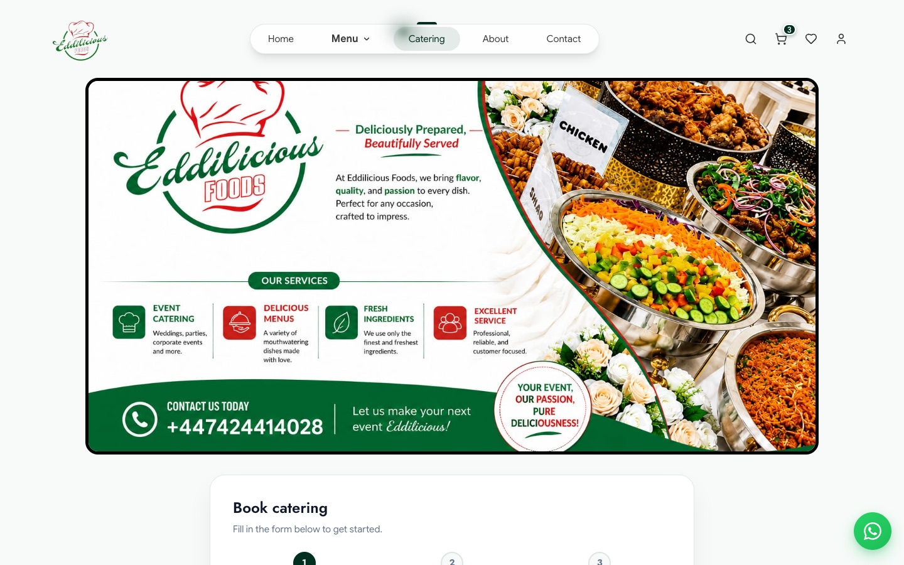 |

Mobile, with the bottom tab bar and sticky add-to-cart:

<p>
  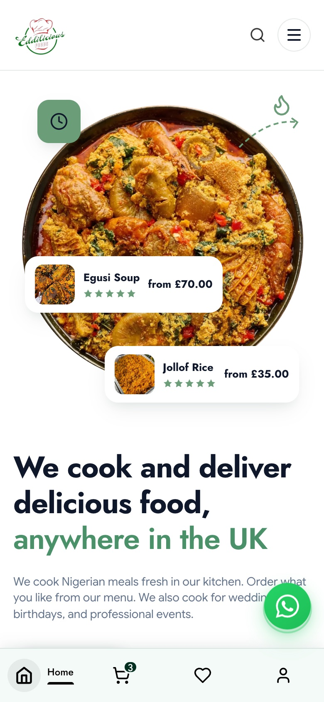
  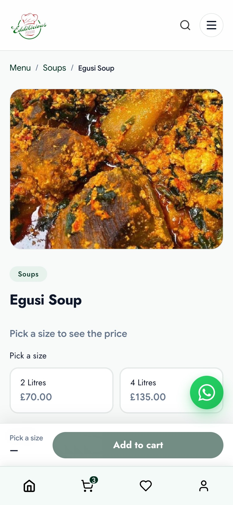
  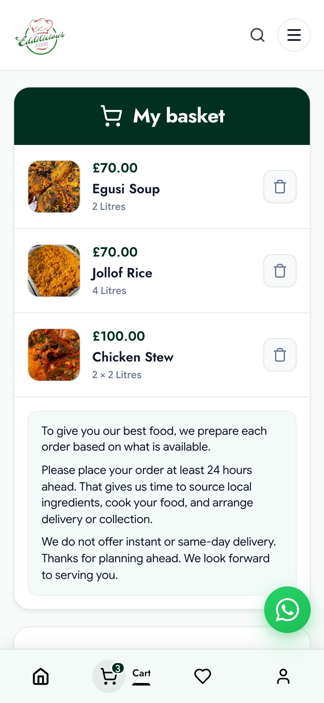
</p>

### Admin

All admin screenshots use seeded demo data. No real customer details are shown.

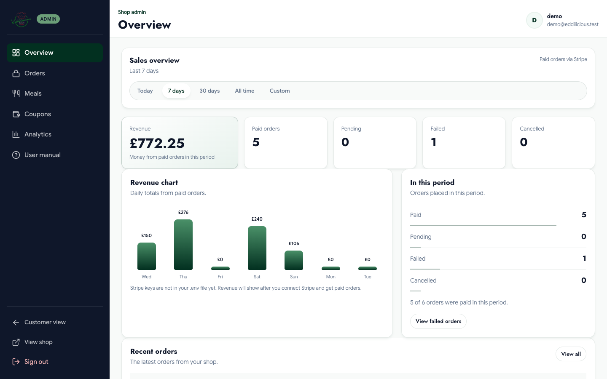

| Orders | Meals |
| --- | --- |
| 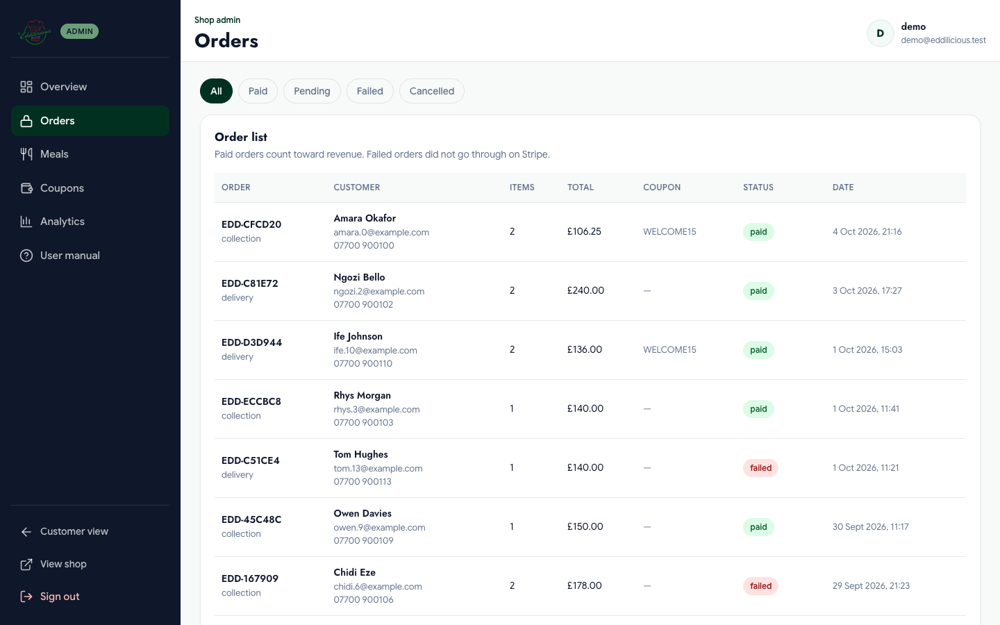 | 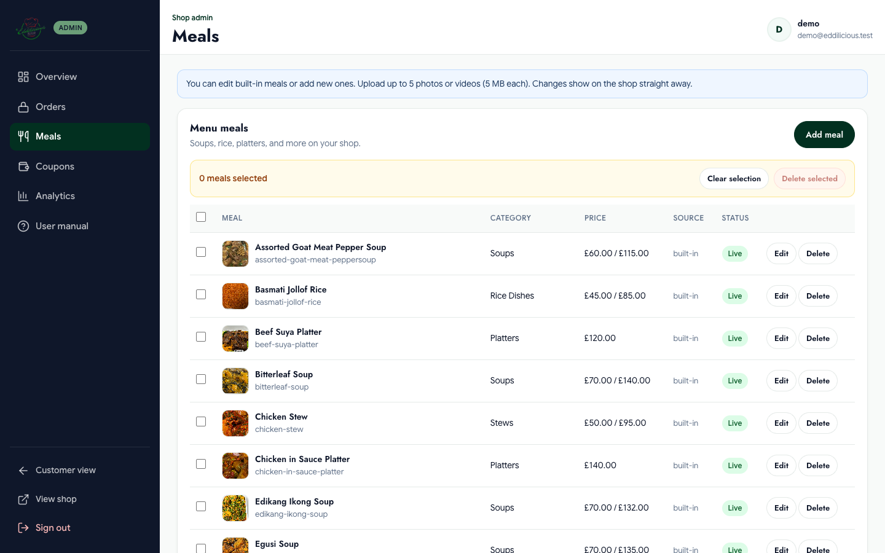 |

| Coupons | Analytics |
| --- | --- |
| 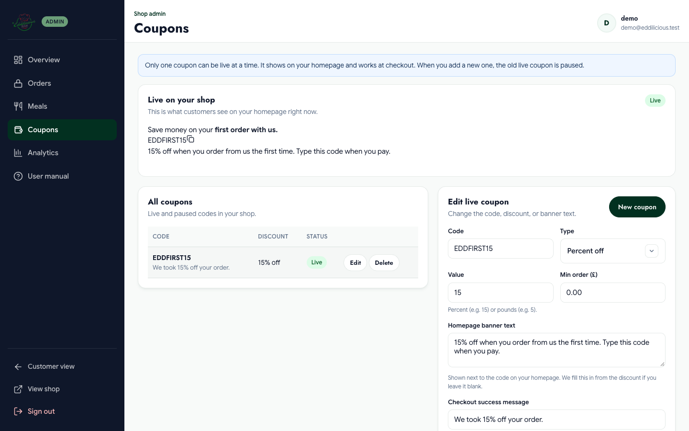 | 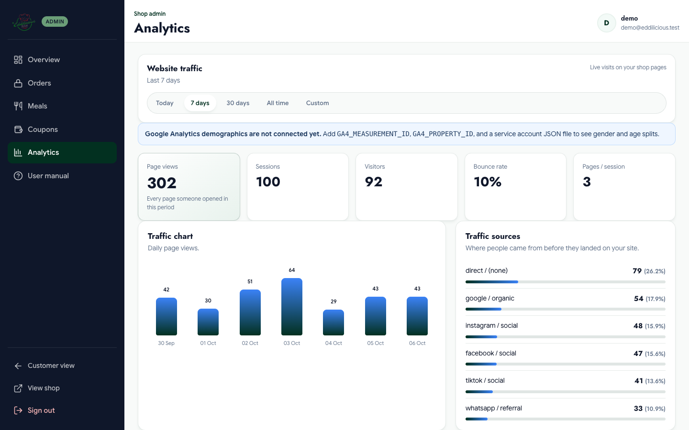 |

The admin on a phone:

<p>
  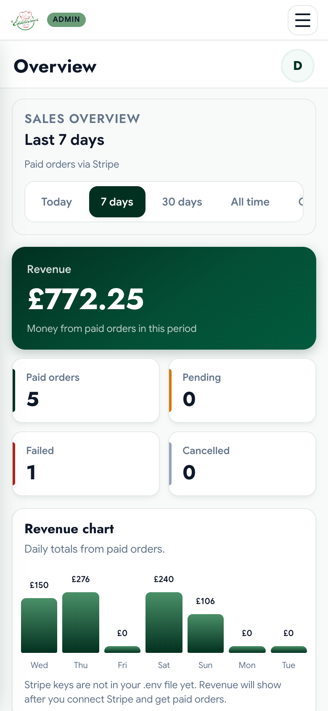
  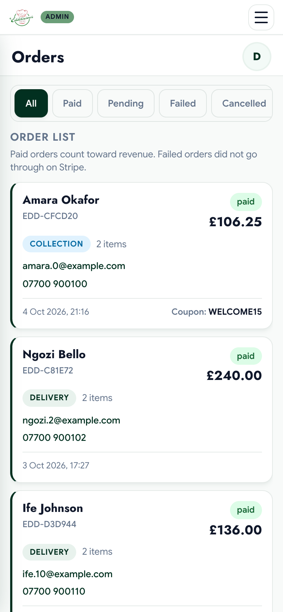
</p>

## Stack

| Layer | Choice |
| --- | --- |
| Server | PHP 8, no framework |
| Database | SQLite through PDO |
| Front end | Server-rendered PHP templates, plain CSS, vanilla JavaScript. No build step. |
| Payments | Stripe Checkout (hosted) plus webhooks, via `stripe/stripe-php` |
| Email | Resend HTTP API (sign-in codes, contact form, catering confirmations, newsletter) |
| Owner alerts | Twilio WhatsApp API |
| Sign-in | Email one-time codes, Google OAuth 2.0 authorisation code flow |
| Analytics | First-party page view tracking, plus the GA4 Data API for demographics |

Why no framework: the client already had cPanel shared hosting with no SSH, no Node, no queue workers and no managed database worth paying for. Whatever I shipped had to work by uploading files over FTP. Plain PHP and SQLite fit that exactly. Stripe is the only Composer dependency.

That constraint is also why there is no front-end build. Every page loads its own small set of CSS and JS files, and `site_asset()` appends the file's modified time as a cache-busting query string, so a re-upload is picked up straight away without a bundler.

## How it is put together

```
.
├── index.php, menu.php, product.php, cart.php, checkout.php, ...   public pages
├── admin/                       admin pages (overview, orders, meals, coupons, analytics, help)
├── api/                         JSON endpoints, one file per action
│   ├── auth/                    send-otp, verify-otp, logout
│   ├── checkout/                create-session
│   ├── stripe/                  webhook
│   ├── admin/                   orders, products, coupons, stats, analytics, uploads
│   └── analytics/, reviews/, catering/, contact/, newsletter/, cookie-consent/
├── auth/                        Google OAuth start and callback
├── includes/
│   ├── auth/                    session, users, OTP, Google, mailer, SQLite connection and migrations
│   ├── payments/                CartValidator, OrderRepository, StripeService, Twilio notifier
│   ├── admin/                   catalogue and coupon repositories, media upload, HTML sanitiser
│   ├── analytics/               page views, geo lookup, user agent parsing, GA4 client, consent log
│   ├── reviews/                 verified review repository
│   ├── data/                    menu catalogue, site copy, legal text, contact details
│   └── partials/                reusable template pieces (product card, gallery, notices)
├── assets/css, assets/js        one stylesheet and one script per page or component
└── storage/                     SQLite file and service account key (never committed)
```

Every request goes through `includes/config.php`, which loads `includes/auth/bootstrap.php`. Bootstrap reads `.env`, starts the session with `HttpOnly` and `SameSite=Lax` cookies, opens SQLite and runs migrations. Migrations are `CREATE TABLE IF NOT EXISTS` plus small "add column if missing" checks, so a fresh upload sets up its own database on the first request.

Data access lives in small static repository classes (`OrderRepository`, `CatalogAdminRepository`, `ProductReviewRepository` and so on) with prepared statements throughout. API endpoints are thin. They check the method, the CSRF token and the session, then call a repository and return JSON.

Tables: `users`, `otp_codes`, `orders`, `catalog_custom_products`, `catalog_product_overrides`, `admin_coupons`, `product_reviews`, `newsletter_subscribers`, `analytics_pageviews`, `analytics_geo_cache`, `cookie_consent_log`.

## Checkout and payments

The basket lives in `sessionStorage`, so the browser is never trusted for money. The flow:

1. The checkout page posts the basket, customer details, fulfilment choice, coupon and allergy acknowledgement to `api/checkout/create-session.php`.
2. The endpoint checks the CSRF token and requires a signed-in user. The order email always comes from the session, not the form.
3. `CartValidator` reprices every line from the server-side catalogue. If a client price differs by more than a penny, the request is rejected with "Prices changed, refresh your basket". Coupons are recalculated server-side too, and one-per-customer codes are checked against that email's previous orders.
4. A `pending` order is written to SQLite with a generated reference, the validated lines and the customer details, before Stripe is involved.
5. A Stripe Checkout Session is created with the order reference in `client_reference_id` and metadata. Discounts are spread across line items so Stripe's totals match ours exactly.
6. The customer pays on Stripe's hosted page.
7. Payment is confirmed in two places, whichever arrives first:
   - the success page retrieves the session from Stripe and checks `payment_status === 'paid'`
   - the `checkout.session.completed` webhook, verified with the signing secret
8. Both call `OrderRepository::markPaidBySessionId()`, which runs `UPDATE ... SET status = "paid" WHERE stripe_session_id = ? AND status = "pending"`. Only the request that actually flips the row sends the owner's WhatsApp alert, so a redirect racing a webhook can't send the alert twice.
9. Expired sessions are marked `failed` by the `checkout.session.expired` webhook.

Delivery is currently free. `delivery_pence` is carried through the whole pipeline (validator, order row, Stripe totals, admin), so distance-based pricing only needs a calculator plugged into `CartValidator`.

## Accounts and admin access

There are no passwords anywhere in the system.

- **Email codes.** Six-digit codes from `random_int`, stored as `password_hash` output rather than plain text. A code expires after 10 minutes and allows 5 attempts. Each address can request 3 codes per 15 minutes. A code issued for sign-in can't be used for sign-up, and the other way round.
- **Google.** Server-side authorisation code flow with a random `state` value kept in the session and checked with `hash_equals` on the way back.
- **Admin.** The admin is the same sign-in, restricted to a comma-separated allowlist in `ADMIN_EMAILS`. Admin pages call `AuthSession::requireAdmin()` and admin APIs call `admin_require_api()`.
- **CSRF.** A per-session token is checked with `hash_equals` on every state-changing endpoint.
- **Uploads.** Meal media is checked by sniffing the file's MIME type with `finfo`, not by trusting the extension. Files are capped at 5 MB and five per meal, and saved under random names. Admin-written descriptions go through an allowlist HTML sanitiser before they are stored.

## Menu data: code plus database overrides

The original menu of around 40 dishes is defined in PHP (`includes/data/menu-catalog.php`). That keeps it in version control and reviewable, and the shop works with an empty database.

The owner still needs to change prices, swap photos and add dishes without calling me. So the admin never edits that file. It writes to two tables:

- `catalog_product_overrides`: per-dish changes to built-in items (price, media, description, hidden flag)
- `catalog_custom_products`: dishes the owner adds herself

`CatalogAdminRepository::mergeWithStatic()` lays the overrides and custom items over the static list at read time. Storefront, search, basket validation and Stripe all read the merged result, so an admin price change is enforced at checkout straight away.

## Analytics and consent

The owner wanted to know where visitors come from without being sent to the Google Analytics UI, so the site counts its own traffic.

- `assets/js/analytics.js` sends a small beacon per page view, but only after the visitor has accepted analytics cookies. If consent comes later, tracking starts at that point.
- The server records path, source and medium (worked out from the referrer and UTM tags), device, browser and OS from the user agent, and location.
- Location comes from Cloudflare's country and city headers when present. Otherwise there is a single ip-api.com lookup, cached per IP. IPs are stored only as hashes.
- Duplicate hits from refreshes are dropped.
- Age and gender are not something you can get first-party, so those come from the GA4 Data API. Rather than pull in Google's SDK, `GoogleAnalyticsClient` builds and signs the service account JWT itself with `openssl_sign` and trades it for an access token.
- Every cookie choice is written to `cookie_consent_log` with a timestamp and a policy version, so there is a record if the owner is ever asked about it.

## Front end

- No framework and no build. Each page includes only the CSS and JS it needs.
- Design tokens in `assets/css/variables.css`: colours, spacing, radii, shadows.
- A fixed typography scale with separate mobile (under 768px) and desktop sets, in `mobile-typography.css` and `desktop-typography.css`. Pages map to roles (`h1`, `h2`, `body`, `meta`...) instead of choosing font sizes ad hoc. This stopped the gradual drift in type sizes that happens over months of small edits.
- Basket, wishlist and coupon state are small modules that fire DOM events (`edilicious:cart-updated` and so on), so the navbar badge, basket page and checkout stay in sync without a state library.
- Product cards use short muted looping videos where the owner has uploaded clips, with a still image fallback. A shell script (`scripts/compress-product-videos.sh`) re-encodes clips to stay light on mobile data.
- Copy is deliberately plain. Short sentences, UK English, GBP, written for the owner's actual customers.

Other bits worth knowing about:

- **Coming-soon gate.** With `SITE_UNDER_CONSTRUCTION=true`, the public sees a holding page with an email sign-up. Visiting any URL with `?preview=<key>` sets a 30-day cookie so the client can review the real site before launch.
- **Owner-facing errors.** Errors are written for whoever will read them. A missing Stripe key shows the owner "add your Stripe keys to .env" in the admin, while customers get "We could not start payment, try again."

## Running it locally

Needs PHP 8.0+ with `pdo_sqlite`, `openssl`, `curl`, `fileinfo` and `mbstring`, plus Composer.

```bash
git clone https://github.com/Choboy-dev/eddilicious-foods.git
cd eddilicious-foods
composer install
cp .env.example .env
```

For a local run, set these in `.env`:

```dotenv
APP_URL=http://localhost:8000
SITE_UNDER_CONSTRUCTION=false
SITE_LICENSE_PAID=true
ADMIN_EMAILS=you@example.com
```

Then:

```bash
php -S localhost:8000
```

Open http://localhost:8000. The SQLite database is created in `storage/` on the first request, so make sure that folder is writable.

The storefront, basket and admin pages all render without any third-party keys. To actually sign in you need `RESEND_API_KEY` (email codes) or the Google OAuth keys. To take a payment you need Stripe test keys, and to test webhooks you can forward them with the Stripe CLI:

```bash
stripe listen --forward-to localhost:8000/api/stripe/webhook.php
```

It also runs unchanged under XAMPP or MAMP from a subfolder. Session cookie paths and asset URLs work out their base path from `APP_URL` and the request.

## Configuration

Everything is set in `.env` (see `.env.example`). Real environment variables take precedence over the file, which is handy for one-off overrides.

| Variable | Purpose |
| --- | --- |
| `APP_URL` | Public base URL, used for Stripe redirects, OAuth callbacks and cookie paths |
| `RESEND_API_KEY`, `RESEND_FROM_EMAIL`, `SITE_NOTIFY_EMAIL` | Outgoing email and where contact or catering messages go |
| `GOOGLE_CLIENT_ID`, `GOOGLE_CLIENT_SECRET`, `GOOGLE_REDIRECT_URI` | Google sign-in |
| `STRIPE_PUBLISHABLE_KEY`, `STRIPE_SECRET_KEY`, `STRIPE_WEBHOOK_SECRET` | Payments |
| `TWILIO_*` | WhatsApp alert to the owner on each paid order |
| `ADMIN_EMAILS` | Comma-separated list of emails allowed into `/admin` |
| `SITE_UNDER_CONSTRUCTION`, `SITE_PREVIEW_KEY` | Coming-soon gate and preview link |
| `SITE_LICENSE_*` | Handover switch used while the project was being paid for. Set `SITE_LICENSE_PAID=true` to turn it off. |
| `ANALYTICS_ENABLED`, `GA4_*` | First-party analytics and optional GA4 demographics |

`.env`, the SQLite database and the GA4 service account file are gitignored and never leave the server.

## Trade-offs and what I would do next

Some of these are conscious decisions for a small business on shared hosting. Others are on the list.

- **SQLite.** One writer at a time is fine for a single kitchen taking tens of orders a day, and it means backups are one file. If order volume or the number of admins grew a lot, the repositories are thin enough to move to MySQL without touching the pages.
- **Delivery pricing.** Delivery is free for now. The next piece of work is distance-based pricing: geocode the postcode with Postcodes.io, get road distance (an OpenRouteService API call, or a self-hosted OSRM instance on a small VPS later), then apply fee bands and a maximum radius inside `CartValidator`. The order pipeline already carries `delivery_pence` end to end.
- **Order dates.** Orders need 24 hours' notice, but at the moment that is communicated rather than enforced. A delivery date picker that blocks the next 24 hours, stored on the order, would make it airtight.
- **Failed payment webhook.** The `payment_intent.payment_failed` handler looks for a `checkout_session_id` in the PaymentIntent metadata, which is never set. In practice abandoned or failed sessions are still closed by `checkout.session.expired`, but the handler should look the order up by `order_ref`, which is in the metadata.
- **Tests.** There is no automated test suite. Pricing, coupon rules, OTP expiry and the paid-order transition are the obvious first candidates for PHPUnit, since that is where a bug costs money.
- **Catalogue in code.** Keeping the base menu in PHP was the right call to get started. Now that the owner manages dishes in the admin, I would seed the database from that file once and make the database the single source of truth.
